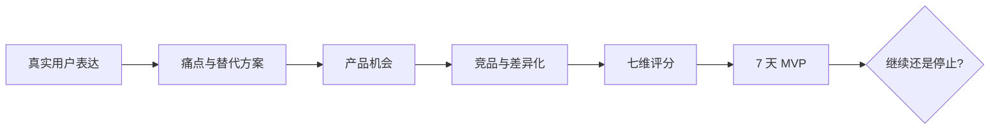

<p align="center">
  
</p>

<h1 align="center">机会捕手 · Opportunity Scout</h1>

<p align="center">
  从真实用户表达出发，把模糊的副业灵感变成<br />
  <strong>有证据、可售卖、7 天内能验证</strong>的产品决策。
</p>

<p align="center">
  
  
  
  
</p>

---

## 不是再给你一份“看起来很对”的分析

很多赛道报告把点赞当需求、把模拟评论当证据、把四个平庸方向都说成“值得做”。机会捕手专门解决这件事：**先验证证据，再做商业判断，最后只选一个最值得先试的方向。**

| 你给它什么 | 它帮你判断什么 | 你最终拿到什么 |
|---|---|---|
| 一个赛道或关键词 | 用户真正卡在哪、现有方案差在哪 | 痛点排序 + 4 个产品机会 + 第一推荐 |
| 一条笔记、产品页或截图 | 用户为什么买、流量从哪来、包装哪里有效 | 九维竞品拆解 + 3 个差异化方向 |
| 一个副业想法 | 值不值得投入、哪里最危险 | 七维评分 + 3 步 MVP + 停止条件 |
| 一个模糊目标 | 从哪里切入最容易成交 | 机会 → 竞品 → 评分 → 验证完整闭环 |

## 四种模式，一条决策链



### A · 发现机会

研究近 3 个月的用户表达，区分痛点频率、痛点强度和付费信号。没有真实样本时，会明确降级为“待验证假设”，不会假装做过全平台统计。

### B · 拆解竞品

从定位、购买理由、流量来源、包装、价格锚点、可借鉴结构与差异化空间等九个维度，拆一条笔记或一个数字产品。

### C · 评估想法

按启动成本、能力门槛、需求、竞争、变现速度、规模化和能力匹配度打分。信息不足的维度标记为 `N/A`，不硬凑总分。

### D · 完整闭环

从赛道研究走到最小验证。最终输出唯一优先推荐、第二备选、放弃理由，以及清楚的继续/停止指标。

## 它如何避免“伪需求”

机会捕手把证据分成三层：

| 标签 | 含义 | 可以支持的结论 |
|---|---|---|
| `已核实` | 可追溯的原始笔记、评论、商品页或访谈 | 样本内事实与具体用户表达 |
| `推断` | 有线索，但缺少完整验证 | 候选解释、流量路径、竞争判断 |
| `待验证` | 经验假设或模拟语气 | 下一步研究和 MVP 假设 |

真实付款、询价和主动寻找替代方案，比点赞、收藏和“大家都在聊”更接近购买需求。**内容热度不是商业需求。**

## 一句话开始使用

```text
用 $opportunity-scout 研究最近 3 个月小红书「AI 提升工作效率」赛道。
目标用户是想做副业的普通人。请找出高频痛点和现有方案缺口，
给 4 个 7 天内能验证的数字产品方向，最后只推荐 1 个。
```

<details>
<summary><strong>拆一个竞品</strong></summary>

```text
用 $opportunity-scout 拆这条笔记/这个产品：[链接、截图或正文]，标价 [金额]。
重点分析用户为什么愿意买、它的包装和流量路径，以及我能做的 3 个差异化版本。
无法核实的内容请明确标成推断。
```

</details>

<details>
<summary><strong>给副业想法打分</strong></summary>

```text
用 $opportunity-scout 评估这个想法：[自然语言描述]。
我的能力是 [能力]，每周能投入 [小时]，预算 [金额]。
请给七维评分、3 步以内的 MVP，以及最大的风险点。
```

</details>

更多可复制提示词见 [使用示例](references/examples.md)。

## 安装

### 安装到当前项目

```bash
mkdir -p .agents/skills
git clone https://github.com/zizixie/opportunity-scout.git .agents/skills/opportunity-scout
```

### 安装到个人 Skills

```bash
mkdir -p ~/.agents/skills
git clone https://github.com/zizixie/opportunity-scout.git ~/.agents/skills/opportunity-scout
```

安装后直接输入 `$opportunity-scout`，或自然地说“帮我研究这个赛道的真实产品机会”。若宿主无法访问目标平台，Skill 会退化为假设和验证计划，不会编造评论、销量或链接。

## 文件结构

```text
opportunity-scout/
├── SKILL.md                  # 路由、流程与质量约束
├── agents/openai.yaml        # Skill 名称、图标、品牌色与默认提示词
├── references/
│   ├── evidence.md           # 证据分级、采样与可信度
│   ├── methods.md            # 机会研究与竞品拆解
│   ├── scoring.md            # 七维评分与决策门槛
│   └── examples.md           # 可复制的调用示例
└── assets/                   # 品牌视觉资源
```

## 适合与不适合

**适合：** 数字资料、模板、Skill、小工具、轻服务；预算有限，希望快速验证；愿意根据真实反馈调整方向。

**不适合：** 想要“保证赚钱”的答案；用虚构评论或销量包装产品；搬运竞品付费内容；在没有证据时直接开发复杂 App。

---

<p align="center">
  <strong>先找到愿意付钱的问题，再去做漂亮的答案。</strong>
</p>
